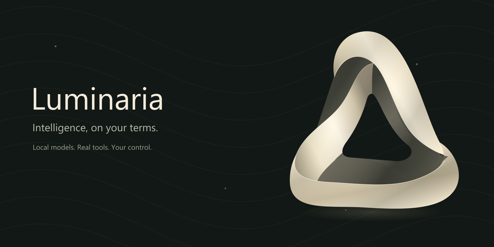

# Luminaria

**Luminaria is a private AI workspace for Windows that runs entirely on your own PC.** It chats with AI models that run on your own graphics card, and it does real work: it reads, writes and organizes files anywhere on your computer, makes Word, Excel, PowerPoint and PDF documents, runs code, researches the web, and uses your other apps. Your conversations, memory and files stay on your machine. There's no subscription and no cloud AI service.

> **Early release.** Luminaria is under active development. The installer isn't code-signed yet, so Windows SmartScreen shows a warning the first time you run it (see [Install](#install) for what to click).

---

## Contents

1. [Why Luminaria](#why-luminaria)
2. [What you need](#what-you-need)
3. [Install](#install)
4. [First launch](#first-launch)
5. [Choosing a model](#choosing-a-model)
6. [Working with Luminaria](#working-with-luminaria)
7. [Your whole PC, with a default folder](#your-whole-pc-with-a-default-folder)
8. [Permissions: how much it may do on its own](#permissions-how-much-it-may-do-on-its-own)
9. [Memory](#memory)
10. [Extensions: skills, connectors and workflows](#extensions-skills-connectors-and-workflows)
11. [Auto mode, hardware and tuning](#auto-mode-hardware-and-tuning)
    - [Model roles and long tasks](#model-roles-and-long-tasks)
    - [Model services and Relay](#model-services-and-relay)
    - [Your PCs, working together](#your-pcs-working-together)
12. [Voice](#voice)
13. [Appearance](#appearance)
14. [Profiles, sign-in and cloud sync](#profiles-sign-in-and-cloud-sync)
15. [Updates](#updates)
16. [Where everything lives](#where-everything-lives)
17. [Privacy and security](#privacy-and-security)
18. [Uninstall](#uninstall)
19. [Troubleshooting](#troubleshooting)
20. [FAQ](#faq)
21. [What's new](#whats-new)

---

## Why Luminaria

- **Private by design.** The AI runs on your hardware. Chats, memory, files and history are stored on your PC, not on someone else's servers.
- **An assistant that does the work.** Luminaria doesn't stop at telling you how to do something. It writes the file, runs the script, checks the result and tells you plainly whether it worked.
- **Plug and play.** One installer. Python, Node.js, the model runtime, the browser and Windows connectors, and the WebView2 runtime are all included. You don't install anything else.
- **Matched to your PC.** Every model in the library is rated against your own graphics card and memory before you download it, so you know what will run well.
- **You're in control.** Choose whether it asks before making changes or works hands-free. Windows itself, saved credentials and its own private data are always off limits to it, and you can undo the file changes a task made.
- **Thousands of extensions.** Thousands of free skills (step-by-step workflows) and connectors (tools for other apps) are built in. Luminaria can find and add the right one when a task needs it, with your approval.

## What you need

| | Minimum | Recommended |
|---|---|---|
| Windows | Windows 10 or 11, 64-bit | Windows 11 |
| Graphics card | Any; small models also run on the processor | A graphics card with 8 GB or more of video memory; 12–16 GB runs the best models comfortably |
| Memory (RAM) | 16 GB | 32 GB |
| Disk space | About 3 GB for the app, plus 2–20 GB per model | An SSD with 50 GB or more free |
| Internet | To download the app and models | Optional after that, except for web research and connectors |

Luminaria installs for your Windows user only and doesn't need administrator rights.

## Install

1. Open the [**Releases**](../../releases/latest) page and download `Luminaria-<version>-Setup.exe`.
2. Double-click the installer.
3. Windows may show **"Windows protected your PC."** This happens because the installer isn't code-signed yet. Click **More info**, then **Run anyway**.
4. Follow the steps. By default Luminaria installs to `Desktop\Luminaria\App` and adds Start menu and desktop shortcuts.
5. When setup finishes, leave **Open Luminaria** ticked and click **Finish**.

The installer removes its temporary files when it's done and keeps only what Luminaria needs to run and update.

## First launch

1. **Sign in.** Luminaria opens a sign-in screen. Choose **Google**, **GitHub** or **Discord**; sign-in completes in your default web browser. Signing in doesn't give Luminaria access to your email, repositories or messages; it only identifies your account so your profile can sync between your devices. Your chats and files stay on this PC.
2. **Make yourself at home.** Name your workspace and choose light, dark, or follow Windows.
3. **Choose a default folder.** This is where new files go when you don't say where. Luminaria can still work anywhere on your PC. You can change the folder any time.
4. **Get a model.** If no model is installed yet, Luminaria shows a small prompt that takes you to the **Model library**. Pick one rated **Recommended** or **Runs well** for your PC and click **Download**. See [Choosing a model](#choosing-a-model).

You're ready. Type a message, or pick a starter such as *Explore a codebase*, *Research an idea* or *Create something useful*.

## Choosing a model

Open **Library › Models** (also in **Settings › Model library**).

### The library
- **Hundreds of local models** from trusted publishers, each in several sizes ("quantizations"). Smaller sizes use less memory and run faster; larger sizes are a little smarter.
- **Vision models** can look at images you attach. They're marked with a vision badge.
- **Search and filter** (All, Installed, Standard, Abliterated, and by capability), and **sort** by best fit for this PC, best AI score, name, size, parameters or recently added.
- **Download all**, **Score my models** and **Remove all** buttons make bulk changes easy. You can remove any model, including the one that's currently active.
- **Select models** lets you pick several models and download or remove them together. Downloads use the best-fit size for your PC, and models too large for it are skipped.

### Fit ratings
Every size of every model is rated against **your** graphics card and memory before you download it:

| Rating | Meaning |
|---|---|
| **Recommended** | Runs fully in graphics memory with room for long context. |
| **Runs well** | Fits with good speed. Context or headroom is somewhat limited. |
| **Runs slowly** | Fits, but part of the model runs from system memory, so replies come slowly. |
| **May be unstable** | Only just fits. Expect out-of-memory errors or freezes under load, or with other apps open. |
| **Too large** | Needs more memory than this PC has. |
| **Not rated** | Graphics memory couldn't be read. Set it in Settings › Hardware & tuning, or run a benchmark. |

If a model's own design limits it (for example, it only supports a short context), the card says so. That way you can tell a limit of the model from a limit of your PC.

### Benchmarks
Click **Benchmark** on any installed size to measure it on your PC. Speed (tokens per second), time to the first word and a quick quality check are saved and shown next to that size.

### AI scores
Every installed model can get an **AI score** out of 100, shown right in the list (for example *AI score 72*). It rates the model's overall ability with 36 fixed questions in six areas, each counting equally:

| Area | What it tests |
|---|---|
| **Reasoning** | Logic puzzles and careful thinking |
| **Math** | Percentages, fractions, probability and equations |
| **Coding** | Reading Python and JavaScript and finding bugs |
| **Knowledge** | Well-known facts |
| **Following instructions** | Exact formats, such as "JSON only" or "exactly four words" |
| **Tool use** | Calling the right tool with the right details, and not calling one when it isn't needed. This is the skill Luminaria needs to do work for you |

- Every question is graded automatically. Code is read, never run, and tool calls are checked, never carried out.
- The test runs on your PC with thinking off and the temperature at 0, so the result is repeatable. It takes a few minutes per model.
- **Score my models** scores every installed model that doesn't have a score yet, one at a time. Hover a score to see each area, and sort by **Best AI score** to see your strongest models first.
- Green means 70 or more, a softer green 45 to 69, and amber below that.
- Auto mode also takes the score into account when it picks a model.
- Scores from the older 12-question check show as *Old score* until you score the model again.

### Abliterated models
Some publishers release "abliterated" versions with their refusal training removed. They're kept under their own **Abliterated** filter and clearly labelled. Use them responsibly.

## Working with Luminaria

### The composer
- **Enter** sends; **Shift+Enter** adds a new line.
- **+** attaches images, PDFs, Word documents, text and code, or a whole folder.
- **Model** picks which model answers, or **Auto** (see [Auto mode](#auto-mode-hardware-and-tuning)).
- **Think harder** gives the model more time to reason before it answers.
- **Plan only** has Luminaria look around and write a plan without changing anything. Approve the plan to carry it out.
- **Microphone** dictates; **voice mode** holds a spoken conversation. See [Voice](#voice).
- You can keep typing while Luminaria works. New messages wait in a queue and send in order.

### Slash commands
| Command | What it does |
|---|---|
| `/new` | Start a new task |
| `/stop` | Stop the current reply |
| `/compact` | Summarize older messages now to free up room |
| `/plan` | Show the current plan |
| `/brief` | Open the pinned working brief |
| `/memory` | Open Memory |
| `/tools` | Open Tools |
| `/skills` | Open Extensions on the Skills tab |
| `/models` | Open the Model library |
| `/skill name` | Use a specific skill for this message |
| `/help` | List the commands |

### Seeing what it does
- **Steps.** Every action appears in the chat in plain English and is grouped and collapsed, for example *"Read 3 files, ran a command and changed a file ▸"*. Click to see the exact inputs and results.
- **Plan.** For multi-step jobs, Luminaria shows its plan and keeps each step's status current as it works.
- **Working brief.** Goals, constraints and decisions for the task stay pinned and survive long conversations. You can edit it; Luminaria can propose changes.
- **Approvals.** In *Ask me first* mode, changes wait for your **Allow** or **Deny**. Approvals are highlighted and never hidden.
- **Checks its own work.** After making a document, spreadsheet, slide deck, PDF, web page or image, Luminaria opens the file to confirm it's real and complete before saying it's done. If a step fails, it says so.
- **Files & activity.** The right-hand panel shows your default folder, a log of every action, and how much of the model's context the chat is using.

### Long conversations
When a chat gets long, Luminaria summarizes older turns for the model and keeps recent turns word for word. The full original history is never deleted; Luminaria can search it and recall exact earlier messages. You can choose when this starts and how many recent turns to keep in **Settings › Memory & context**.

### Documents
Ask for a Word document, Excel spreadsheet, PowerPoint deck or PDF and Luminaria builds the real file with its built-in libraries, saves it where you asked (or in your default folder), checks it, and tells you where it is.

## Your whole PC, with a default folder

Luminaria isn't confined to one folder. **Name any folder, drive or file in your message** and it works there:

- *"Tidy up D:\Photos into folders by year."*
- *"Summarize the PDF on my Desktop."*
- *"Find every TODO in C:\Projects\website."*

It knows where your Desktop, Documents, Downloads and drives are, so you don't have to type full paths.

The **default folder** (Settings › Default folder) is simply where new files go when you don't say where, and what "this folder" means. If a folder has a `LUMINARIA.md` file, Luminaria reads it before working there (see [Memory](#memory)).

**Always off limits, in every mode:** the Windows folder, credential folders such as `.ssh`, Luminaria's own private settings, history and sign-in data, other people's profiles on this PC, the Recycle Bin and Windows' recovery folders. Commands and scripts that name these places are refused too. Skill folders can be read but not changed.

**Program Files and ProgramData** are open to Luminaria, but changing anything there always asks you first, even in Full access.

**No administrator commands.** Luminaria doesn't run commands as administrator. When a step needs it, it tells you so you can do that part.

**Undo file changes.** After a task, **Undo file changes** in the status line shows every file the task changed, created or deleted, and puts them back. A file that you or another program changed afterwards is left alone, and anything a command or script did (an installed program, an online action) can't be undone; the list says so before you confirm.

## Permissions: how much it may do on its own

Open **Settings › Permissions**, or click the mode chip at the top of the window.

| Mode | Reads and searches | Changes, commands, network |
|---|---|---|
| **Ask me first** (default) | Run on their own | Wait for your approval |
| **Hands-free** | Run on their own | Run on their own |

- **Grant full access** turns on Hands-free and every tool in one click.
- **Computer and command tools** turns on PowerShell, code, the browser and Windows desktop tools. These act with your Windows permissions.
- **Ask before reads too** makes *Ask me first* also ask before reading files and searching.
- **Delete** always asks first and keeps a recovery copy.
- **Reset remembered approvals** clears any "always allow" choices.

Luminaria isn't an operating-system sandbox. Anything you allow it to do runs as your Windows user.

## Memory

Memory is plain Markdown that you can read and edit, like a notes file. Open **Library › Memory**.

### My memory (`MEMORY.md`)
- One page per profile, used in **every chat and every folder**, and synced with your account.
- Sections: **About me**, **Preferences**, **Notes**. Edit, reorder or delete anything.
- Say *"remember that I prefer short answers"* and Luminaria adds a dated line under **Notes**.
- **Edit** and **Preview** views, **Save** or **Ctrl+S**, and a warning if you close with unsaved changes.

### Project notes (`LUMINARIA.md`)
- Any folder can have its own `LUMINARIA.md` with notes about that project: what it is, how it's organized, conventions to follow.
- **This project** in Memory edits the notes for your default folder. **Start project notes** fills in a starter template.
- Luminaria reads project notes at the start of every task in that folder and keeps them up to date when it learns lasting facts.

Memory is loaded at the top of every request word for word, so the model can reuse its earlier work and replies start faster in long chats.

## Extensions: skills, connectors and workflows

Open **Library › Extensions**. Everything works the same way: each item shows what it is, whether it's ready, one main button, and setup as numbered steps.

| Tab | What's there |
|---|---|
| **Installed** | Everything you have, grouped into skills, connectors and workflows |
| **Browse** | The built-in catalog of thousands of free skills and connectors. **Install** is one click; you confirm first. |
| **Skills** | Grouped by *Needs setup*, *Ready* and *Off*. **Use** sends `/skill name` to the composer. **Add your own skill** imports a Markdown file. |
| **Connectors** | Services like **GitHub, Gmail, Google Drive, Google Calendar and Slack**, the built-in **Browser** and **Windows** connectors, and **Add your own connector** for any MCP server. |
| **Workflows** | **Automations** (prompts that run on a schedule) and **File workflows** (reviewable plans for changing many files). |

- **Skills** are step-by-step instructions Luminaria follows for a kind of task, such as documents, research, code review, planning or GitHub chores. They never add credentials or skip approvals.
- **Connectors** give Luminaria tools for other apps. Each service is connected with its own sign-in or token, which is encrypted on your PC. Read-only access is on by default where the service supports it.
- **When something needs setup**, its steps take you straight to the fix: *Set up GitHub*, *Open Permissions* and so on.
- **Luminaria can find extensions for you.** If a task needs a skill or connector you don't have, it searches the catalog and asks before installing.
- Connectors from the catalog run third-party code on your PC. Install only ones you trust.

## Auto mode, hardware and tuning

- **Auto mode** (Settings › Auto mode) picks the most suitable installed model for each message: a fast model for quick questions, a stronger one for hard work. You can limit which models it may choose.
- **Hardware & tuning** shows the graphics card, memory and processor Luminaria detected. Settings are chosen automatically, and **tuning** can measure the fastest settings for your PC, such as processor threads and how much of the model goes on the graphics card. Context size and reply length are in **Settings › Memory & context**.
- Only one model is loaded on your graphics card at a time. Switching models loads the new one on demand.
- **Idle means idle.** When a reply or task is done, Luminaria stops and unloads the model from your graphics card. The bottom corner shows *Model off*, *Model loaded · unloads in…* or *Model working*. To keep the model loaded for 5 or 30 minutes so your next message starts faster, change **After it finishes** in Settings › Hardware & tuning.

### Model roles and long tasks
Luminaria gives different jobs to different models:

| Role | What it does | Default |
|---|---|---|
| **Planning model** | Makes plans with you (Plan only) and checks finished work, with thinking on | Your strongest installed reasoning model |
| **Coding model** | Does the coding steps when a plan is carried out | Your best installed coding model |
| **Chat model** | Everything else | The model you pick in the message box, or Auto |

The model picker labels the current picks (*Plans and checks*, *Codes plan steps*). To change them, go to **Settings › Model roles**. Luminaria loads and swaps models by itself as the work moves between roles.

**Carrying out a plan:** make a plan with **Plan only**, then open the plan card and choose **Carry out plan**.
1. Luminaria works through the steps one at a time. Each step starts with a clean slate: the plan, short notes from earlier steps, and its own work.
2. It marks each step done, or blocked if something stops it.
3. At the end, the planning model checks the whole result against the goal.

### Model services and Relay
Besides the models on your PC, Luminaria can use **model services**: OpenRouter (including its free models), Groq, Gemini, OmniRoute, Ollama, LM Studio, or any service that works like OpenAI's API. (To use your own other PCs, pair them instead: see below.)

1. Open **Settings › Model services › Add a model service**.
2. Pick a service, or enter its address, and add your API key if it needs one. Keys are encrypted on your PC.
3. Its models appear in the model picker under **Model services**.

**Relay:** set a model service as your **Coding model** in Settings › Model roles. When Luminaria carries out a plan, it relays the coding steps to that service, while your own PC plans the work and checks the result.

**Privacy:** each service has a **May see my files** switch, off by default. When it's off, the service receives only the conversation text. It never gets file contents, command output or your memory, and it can't use file tools. Auto never sends anything to a model service on its own. Free services have usage limits and their own terms, so check them before relying on one.

### Your PCs, working together
Everything is in **Settings › Paired PCs**.

1. **On the PC to share:** turn on **Let other PCs pair with this one**. It shows a 6-digit code that works once, for 10 minutes. Windows may ask to allow Luminaria on private networks: choose **Allow**.
2. **On your other PC:** choose **Pair with another PC** → **Look for PCs**, pick it, and enter the code. If it isn't found, type its address (shown on the first PC).
3. **That's it.** Its models now appear under *Paired PCs* in the model picker. Auto mode and the model roles use them like your own, so Luminaria can plan on one PC while another codes, passing the work back and forth. Your files stay on the PC you're using.

**Split big models:** with at least one paired PC, turn on **Split big models across paired PCs**. The next message loads the model across all the graphics cards, so models too big for one PC can run. This uses llama.cpp's RPC system, which has no password: use it only on your own home or office network.

To stop, choose **Unpair** on the paired PC's card, or turn off **Let other PCs pair** on the shared PC.

## Voice

- **Dictation** turns speech into text in the composer.
- **Voice mode** holds a spoken back-and-forth conversation, with an audio-reactive orb.
- Speech recognition and the spoken voice run **offline on your PC**; no audio is uploaded. Voice currently supports English.
- Choose your microphone and voice settings in **Settings › Voice**.

## Appearance

**Settings › Appearance**: light, dark or follow Windows, an accent color, every color editable for each mode, the background glow color profiles (**Aurora**, **Ember**, **Ocean**, **Forest**, **Mono** or off), the living orb, motion level, and a reduced-graphics mode for older PCs. Your color profile carries across light and dark mode, and every page, including Model services and Paired PCs, uses its colors. Luminaria also follows Windows' *reduce motion* setting.

## Profiles, sign-in and cloud sync

- **Profiles** keep separate chats, memory, settings and files for each person who uses the PC.
- **Sign-in** with Google, GitHub or Discord happens in your browser. You can link several sign-in methods to one account in **Settings › Sign-in & devices**, and require sign-in when Luminaria opens.
- **Cloud sync** (optional) carries your account data, such as chats, memory and settings, between your devices. The AI itself always runs on your desktop.
- **Insights** shows how you use models, tools and skills on this PC.

## Updates

**Settings › Updates** checks for new versions. When one is available, Luminaria tells you, downloads the installer, checks its SHA-256 checksum against the published one, and installs only after you confirm. Your chats, memory, models and files are kept.

## Where everything lives

All of Luminaria's own things live in one folder, by default `Desktop\Luminaria\App`:

| Folder | What's in it |
|---|---|
| `App\` | The program |
| `App\data\` | Your settings, chats, history, memory (`MEMORY.md`), installed skills and connector settings. Private: the assistant can't read it. |
| `App\models\` | Downloaded models |
| `App\Files\` | The default folder for each profile, unless you choose another |

The files Luminaria creates for you go wherever you ask, anywhere on your PC.

## Privacy and security

- **Local AI.** Models run on your PC. Your messages aren't sent to an AI provider.
- **Local app.** Luminaria's interface talks to its own backend on your computer only. Every request is checked for a per-session security token.
- **Encrypted secrets.** Connector tokens and keys are encrypted for your Windows account.
- **Protected places.** Windows, credential folders and Luminaria's private data are never available to the assistant. Changes under Program Files and ProgramData always ask first.
- **Safe web reading.** Web fetch never opens private or local network addresses. Web pages and files are treated as information, never as instructions.
- **Verified updates.** Installers are checked against a published checksum before they run.
- **Untrusted extensions.** Skills and connectors from outside sources can steer what Luminaria does or run code. Read what you install.

## Uninstall

Open **Windows Settings › Apps › Installed apps**, find **Luminaria**, and click **Uninstall**. To also remove your chats, memory and models, delete the `Desktop\Luminaria` folder afterwards.

## Troubleshooting

| Problem | What to do |
|---|---|
| "Windows protected your PC" when installing | Click **More info › Run anyway**. The installer isn't code-signed yet. |
| "No model is installed yet" | Open **Settings › Model library** and download a model rated **Recommended** or **Runs well** for your PC. |
| "Model server offline" | Open the Model library and load a model. If it persists, restart Luminaria. |
| Replies are slow | Choose a smaller size rated **Recommended**, lower the context size in Hardware & tuning, or close other apps using your graphics card. |
| A skill says **Needs setup** | Open it in Extensions and follow its steps. |
| A connector says **Not working** | Open it in Extensions › Connectors and click **Fix**, or **Disconnect** and connect again. |
| Browser or Windows tools don't run | Turn on **Computer and command tools** in Settings › Permissions. |
| "That location is protected" | Luminaria can't use Windows, credential folders, other people's profiles or its own private data. Choose another folder. |
| The default folder can't be opened (for example an unplugged drive) | Luminaria uses a fallback folder for now. Choose a new one in **Settings › Default folder**. |

## FAQ

**Does Luminaria need the internet?**
Only to download the app and models, and for things that are online by nature: web research, connectors, sign-in, sync and updates. Chatting with a local model works offline.

**Is it really free?**
Yes. There's no subscription and no per-message cost. Models are free, openly licensed downloads.

**Can it change or delete my files?**
Only as your permission mode allows. In *Ask me first* it asks before every change. Deleting always asks and keeps a recovery copy.

**Can it see my whole PC?**
It can work in any folder you name, except Windows, credential folders and Luminaria's own private data. Changes under Program Files and ProgramData always ask first.

**What's the difference between a skill and a connector?**
A skill teaches Luminaria *how* to do a kind of task. A connector gives it *tools* for another app or service.

**Is there a mobile app?**
Not yet. It's planned once the desktop app is fully polished.

## What's new

See the [Releases](../../releases) page for each version's notes.

---

Luminaria uses open-source components; their licenses are in the <code>licenses</code> folder. Models are provided by their publishers under their own licenses.
